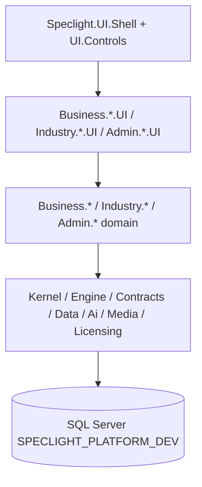

# PROJECT_CONTEXT — SpeclightPlatform

> Auto-generated for Gemini / GitHub sync. Asia/Saigon.
> Solution root: `E:\SPECLIGHT\SPECLIGHT\repos\SpeclightPlatform`
> Repo: `https://github.com/gyunok/SpeclightPlatform.git` (private)
> Tip at generation time: `phase2/e15c-corel` after merge `planc/ph01_26_pack` @ `7a05765`.

## 1. Tổng quan & mục đích

**SpeclightPlatform** là hệ thống quản trị / nghiệp vụ Speclight (WPF/.NET 8) cho ngành chiếu sáng & nội thất: catalogue sản phẩm/SKU, đối tác, dự án, báo giá, kho, định giá, OEM, CAD preview (view-only), AI hỗ trợ, phân quyền tenant.

Database chính (DEV): `SPECLIGHT_PLATFORM_DEV` trên `localhost` (Windows Auth / Integrated Security, `sqlcmd -C`).

## 2. Kiến trúc Solution (layers)



- **Shell**: host WPF navigation, DI, appsettings.
- **Business modules**: Catalog, Partners, Projects (Quote), Pricing, Inventory, Oem — thường tách domain + `*.UI`.
- **Industry**: Lighting, Furniture (+ UI).
- **Admin**: Security, Settings (+ UI).
- **Data**: persistence + `Speclight.Data.Migrations`.
- **Tests**: Architecture / Engine / Kernel / Data.Integration / LegacyImport / Licensing — nhiều Category `PH*` cho pack Platform PH-01..26.

## 3. Danh sách Project & module chính

### Core / platform
| Project | Vai trò |
|---|---|
| Speclight.UI.Shell | Entry app, navigation hub, composition root |
| Speclight.UI.Controls | DataGrid V3, shared controls/styles |
| Speclight.Kernel | Domain primitives, messaging |
| Speclight.Engine | Orchestration / workflows |
| Speclight.Contracts | Shared contracts/DTOs |
| Speclight.Data | Persistence |
| Speclight.Data.Migrations | Schema migrations |
| Speclight.Ai | AI quota / helpers |
| Speclight.Media | Assets / media roles |
| Speclight.Import / LegacyImport | Import pipelines |
| Speclight.Licensing | License checks |

### Business
| Project | Vai trò |
|---|---|
| Speclight.Business.Catalog (+UI) | Product/Item, SKU picker search, warehouse catalog, variant/lumen grids |
| Speclight.Business.Partners (+UI) | Partner manager 6-tab, OEM intake |
| Speclight.Business.Projects (+UI) | Project hub, quotation, price plan A/B/C/D, product pick snapshot |
| Speclight.Business.Pricing (+UI) | Pricing hub 3-step |
| Speclight.Business.Inventory (+UI) | SkuMaster, goods receipt/issue |
| Speclight.Business.Oem (+UI) | OEM flows |

### Industry / Admin
| Project | Vai trò |
|---|---|
| Speclight.Industry.Lighting (+UI) | Lighting industry features |
| Speclight.Industry.Furniture (+UI) | Furniture industry features |
| Speclight.Admin.Security (+UI) | Users/roles/permissions |
| Speclight.Admin.Settings (+UI) | Tenant settings / feature flags |

### File / module nổi bật gần đây
- Search / SKU: `SearchHubPage`, SKU picker search + AI audit, stock pin (PH-23), dynamic columns (PH-24).
- Quote / Project: quote UI + WebView2 preview (PH-20), price plan (PH-25), product pick (PH-21), project partners/positions (PH-22).
- UI shell: DataGrid V3 default, header filter cue, product card strip, range slider, pictures grid.

## 4. Database overview (`SPECLIGHT_PLATFORM_DEV`)

- **~115 user tables**, **~207k rows** (tại thời điểm sync).
- Schemas: `prod`, `inv`, `ptn`, `prj`, `prc`/`price`, `cad`, `media`, `meta`, `plt`, `audit`, `ops`, `cat`/`dict`, `acct`, `fin`, `ord`, `bom`.

### Bảng lớn (top)
| Schema.Table | ~Rows | Ý nghĩa |
|---|---:|---|
| inv.SkuBomMapping | ~73k | Mapping BOM SKU |
| prod.ItemClosure | ~62k | Closure hierarchy Item |
| prod.ItemAttrValue | ~23k | Giá trị thuộc tính Item |
| prod.Item | ~20k | Master Item/Product |
| inv.SkuMaster | ~4.2k | SKU master |
| media.Asset / ItemAsset | ~2.8k | Media assets |
| ptn.Partner | ~40 | Đối tác |
| prj.Project | ~16 | Dự án |

### FK chính (parent → child)
- `plt.Tenant` → bảng tenant-scoped
- `prod.Item` → `ItemAttrValue`, `ItemPrice`, `ItemRelation`, `media.ItemAsset`
- `inv.SkuMaster` → `SkuBomMapping`, `SkuSupplier`, chi tiết nhập/xuất
- `ptn.Partner` → Address/Contact/Bank + OEM
- `prj.Project` → ProjectProduct / Drawing / PlanOption
- `meta.GridDef` / `FormDef` / `NavItem` → metadata UI V3

DDL: `Database_Sync/01_Schema.sql`. Full INSERT: `Database_Sync/02_FullData.sql` (+ manifest JSON).

## 5. Tính năng hoàn thiện gần đây & trạng thái

### Pack Platform PH-01..26 (2026-10-25)
- Pack branch: `planc/ph01_26_pack` @ `7c647bc` (đã gồm quote_side PH21/22/25).
- Merged **local** vào `phase2/e15c-corel` @ **`7a05765`** (no push).
- BOT1 TEST: Release 0 Error; **124/124** PH Category PASS x2 + **84/84** Architecture trên `_E19`.
- BOT2 REVIEW: **GO**.
- Highlight: DataGrid V3 / UI style, Search stock pin, SKU picker + AI audit, Partner 6-tab, Warehouse catalog, Quote price plan & pick, Project hub, Pricing hub 3-step; CAD M&E viewer đã có trên e15c trước đó.

### Trạng thái hiện tại
- Checkout: `phase2/e15c-corel` @ `7a05765`.
- Hub LAN: `http://192.168.1.2:8787/`.
- Làm mới DB scripts: `sync_github.ps1`.

## 6. Cách chạy local

```powershell
cd E:\SPECLIGHT\SPECLIGHT\repos\SpeclightPlatform
dotnet build SpeclightPlatform.sln -c Release
# Connection: src\Speclight.UI.Shell\appsettings.Development.json (key Platform)
# sqlcmd -S localhost -E -C -d SPECLIGHT_PLATFORM_DEV -Q "SELECT DB_NAME()"
powershell -NoProfile -ExecutionPolicy Bypass -File .\sync_github.ps1
# Skip push: .\sync_github.ps1 -SkipPush
```

**Cảnh báo**: `02_FullData.sql` chứa dữ liệu thật — chỉ commit/push lên repo **private**.
